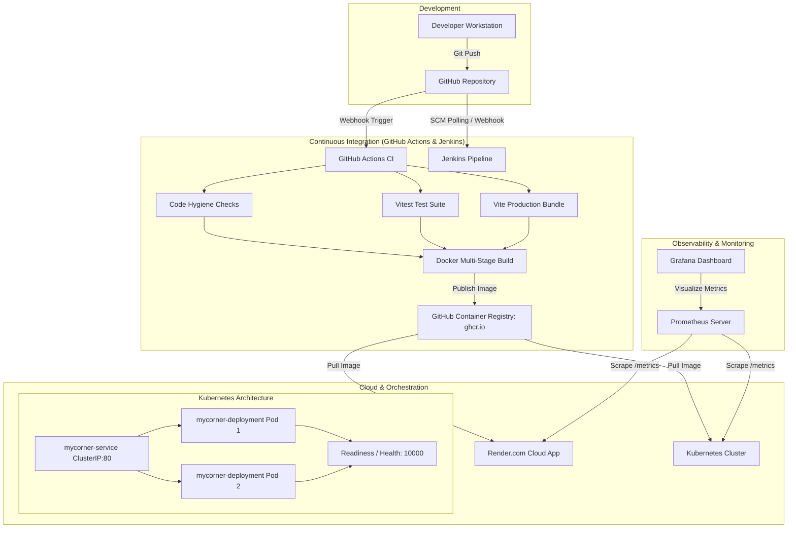

# System Architecture — MyCorner

This document details the architectural layout and continuous delivery pipeline for MyCorner.

## Architectural Highlights

- **Multi-Stage Containerization**: Minimizes image attack surface and final image size using `node:20-alpine` for asset compilation and `nginx:alpine` for fast static asset delivery.
- **Resilient Health Probing**: K8s Deployment features liveness and readiness probes connected to `/health` to guarantee zero-downtime rolling updates.
- **Standardized Prometheus Observability**: Custom scraping configuration pulling operational indicators from `/metrics`.
