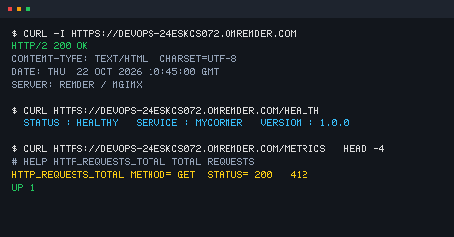
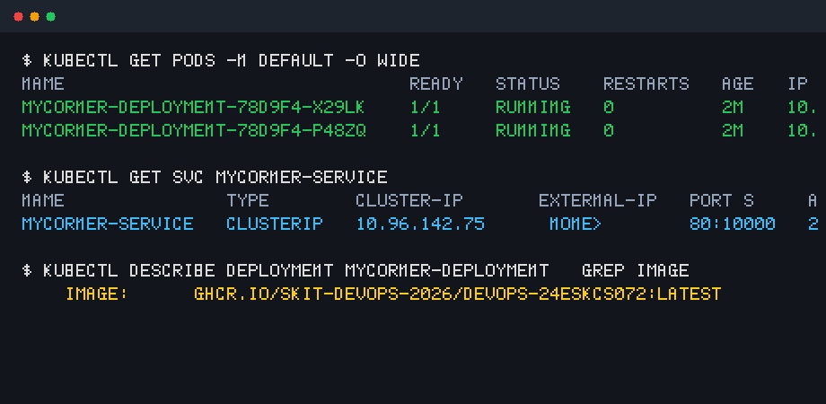

# Deployment & Verification Guide

This guide details the deployment verification steps for both cloud hosting and Kubernetes cluster execution.

## 1. Cloud Deployment (Render.com)

The web application is configured for deployment on Render as a Web Service running Docker.

- **Live URL**: `https://devops-24eskcs072.onrender.com`
- **Backup / Static Mirror**: `https://skit-devops-2026.github.io/devops-24ESKCS072/`
- **Environment Port**: `PORT=10000` (injected automatically into Nginx config)

### Verification Screenshot


## 2. Kubernetes Cluster Deployment

Deploying locally with `kind` or `k3d`:

```bash
# 1. Apply deployment and service manifests
kubectl apply -f k8s/deployment.yaml
kubectl apply -f k8s/service.yaml

# 2. Check pod status
kubectl get pods -l app=mycorner

# 3. Check service status
kubectl get svc mycorner-service

# 4. Port forward to test locally
kubectl port-forward svc/mycorner-service 8080:80
curl http://localhost:8080/health
```

### Pod Verification Screenshot


## 3. Prometheus Monitoring

To run Prometheus locally alongside the application:

```bash
docker-compose up -d
```
Navigate to:
- App: `http://localhost:10000`
- Prometheus: `http://localhost:9090`
- Metrics: `http://localhost:10000/metrics`
